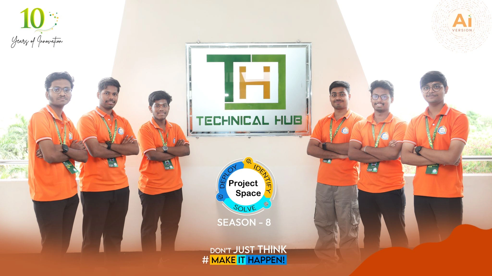
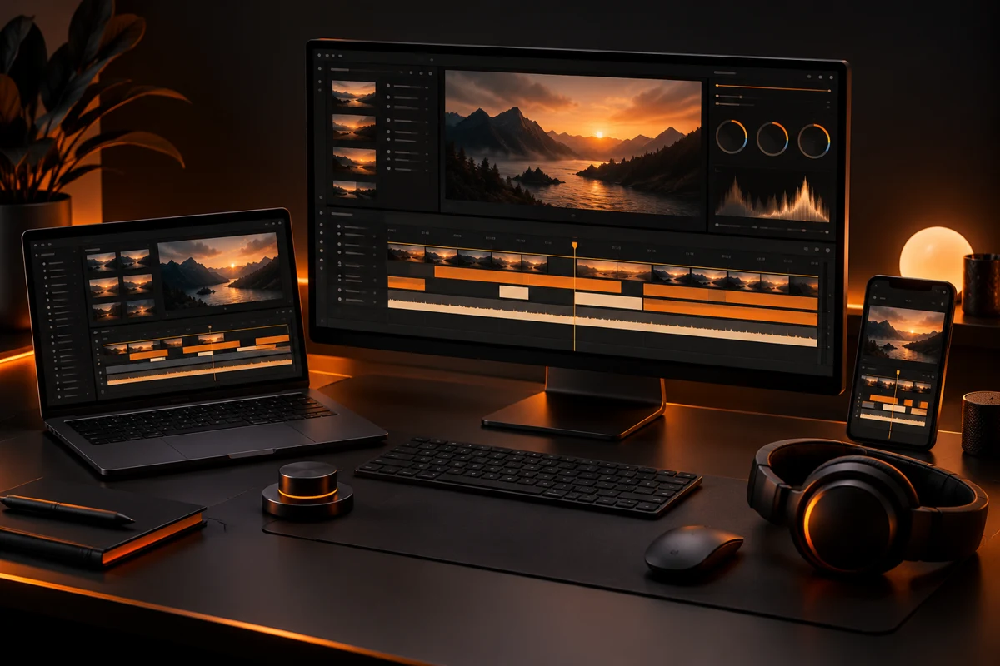

<div align="center">


<p><strong>THE PORTFOLIO / S S LOKESH KODAMANCHILI</strong></p>

# Curious by nature.<br>Building with purpose.

### Data Analytics · Workflow Automation · AI

Final-year **CSE — Artificial Intelligence & Machine Learning** student.<br>
Turning learning into projects, ideas into workflows, and experiences into growth.


[**Meet me**](#01--the-person-behind-the-projects) · [**Project Space**](#02--seven-days-one-memorable-milestone) · [**Selected work**](#03--ideas-put-into-practice) · [**Beyond code**](#04--a-different-kind-of-timeline) · [**Run locally**](#06--make-it-run)

[LinkedIn](https://www.linkedin.com/in/s-s-lokesh-kodamanchili-a8678b348/) &nbsp; / &nbsp; [GitHub](https://github.com/lokeshkodamanchili) &nbsp; / &nbsp; [Instagram](https://www.instagram.com/lok_i028/) &nbsp; / &nbsp; [Email](mailto:satyalokesh.ks@gmail.com)

</div>

---

## 01 / The person behind the projects

I’m **S S Lokesh Kodamanchili**, a final-year student at **Aditya College of Engineering & Technology, Surampalem**, expecting to graduate in **2027**.

I enjoy working where data, automation, and practical applications meet. My journey through Technical Hub training, internships, and team projects has taken me from programming foundations to dashboards, Microsoft 365 workflows, and AI-enabled applications.

This portfolio brings that journey together—with the work, the people, and the learning behind it.

| What I explore | What it looks like in practice |
| :--- | :--- |
| **Data & analytics** | Excel, Power BI, SQL, Python, Snowflake, and cloud analytics. |
| **Workflow automation** | Connected experiences with Power Automate, Forms, SharePoint, Excel, and Outlook. |
| **AI & applications** | Collaborative projects using generative AI, web technologies, and APIs. |
| **AI-assisted development** | Vibe coding: exploring ideas and building applications with AI coding tools. |

**[View my resume ↗](assets/resume/Lokesh-Resume.pdf)**

## 02 / Seven days. One memorable milestone.

### Project Space 8.0 — My First Hackathon-Style Experience



| The setting | The project | The milestone |
| :--- | :--- | :--- |
| **6–12 May 2026** · Aditya University | **Student 360°** · Team 8 | Selected among **20 of 160 teams** for the main-stage presentation. |

A week of ideation, development, integration, testing, documentation, mentorship, and presentation. My role as a **Workflow Automation Developer** focused on processes and integrations between applications and services.

The experience strengthened my technical understanding, teamwork, and confidence in communicating what we built. Our team was selected to present; we were **not among the final 13 winning teams**.

**[Explore Student 360 ↗](https://github.com/lokeshkodamanchili/STUDENT-360)** · **[Watch the platform demo ↗](https://github.com/lokeshkodamanchili/STUDENT-360/blob/main/Documentation%20%26%20Demo/Video%20Demo/captioned%20%26%20voiceover%20video%20demo..mp4)**

## 03 / Ideas put into practice

| Project | The idea | Explore |
| :--- | :--- | :--- |
| **Student 360° + SecureExam** | Bring academics, assessments, achievements, and coding activity into a connected student platform with an Electron exam client. | [Web platform](https://github.com/lokeshkodamanchili/STUDENT-360) · [Desktop client](https://github.com/lokeshkodamanchili/STUDENT-360-ELECTRON-APP) |
| **CertiFlow** | Automate individual and bulk participant certificate workflows with Microsoft 365. | [Source & demos](https://github.com/lokeshkodamanchili/certiflow-showcase) |
| **TimeCapsule** | Preserve senior academic resources and automate controlled access for juniors. | [Source & demos](https://github.com/lokeshkodamanchili/TimeCapsule) |
| **Citizen AI** | Explore conversational civic assistance, feedback classification, and sentiment insights. | [Source & demo](https://github.com/lokeshkodamanchili/Citizen-AI-Intelligent-Citizen-Engagement-Platform) |
| **EcoSense** | Make waste classification, disposal guidance, maps, and analytics easier to explore. | [Source & demo](https://github.com/lokeshkodamanchili/Sustainable-Waste-Management-AI-Assistant) |

**More explorations:** SkillForge AI · HR Analytics in Power BI · Telugu Movies in Power Apps · Customer Care analysis in Excel · GATE DA planner · Bhaai PDFs.

## 04 / A different kind of timeline.

Creative experiments have a place alongside my technical journey.

| **Video Editing** | **Content Creation** |
| :---: | :---: |
|  |  |
| Basic editing with **CapCut on PC and mobile, Adobe Premiere Pro, and DaVinci Resolve**, while exploring new tools and techniques. | Funny videos and edited content for **Instagram and YouTube**, experimenting with timing, storytelling, and creative ideas. |

## 05 / The experience, by design


- **Orange, charcoal, and motion** — light/dark themes, smooth scrolling, hero reveal, and interactive details.
- **A journey worth exploring** — a seven-day event timeline and a full-size photo viewer.
- **Projects with context** — descriptions, technologies, contributions, repository links, and available demos.
- **Ask about Lokesh** — a floating portfolio guide with curated local answers and relevant links.
- **A simple next step** — a refreshed contact panel and downloadable resume.
- **Built for different screens** — responsive layouts, keyboard controls, and reduced-motion styling.
- **A cinematic touch** — background music with a playback control.

The assistant uses a local knowledge base, **not a generative AI service**. It acknowledges unknown questions; chat messages are not submitted to a server.

## 06 / Make it run

**No installation. No build step.**

From the repository directory:

```sh
python3 -m http.server 8080
```

Open **http://localhost:8080**.

<details>
<summary><strong>Publish with GitHub Pages</strong></summary>

In the repository, open **Settings → Pages**. Select **Deploy from a branch**, choose **main** and **/(root)**, and save.

Relative asset paths also make the site suitable for other static hosts.

</details>

<details>
<summary><strong>A quick map for future updates</strong></summary>

| Change | Where |
| :--- | :--- |
| Copy, sections, and links | `index.html` |
| Personal layouts and responsive styling | `assets/portfolio.css` |
| Base styling | `assets/main.css` |
| Scroll animations, hero reveal, fog, and tilt | `assets/scripts.js` |
| Gallery, terminal, and fallback controls | `assets/ui.js` |
| Chatbot knowledge and interface | `assets/assistant.js` · `assets/assistant.css` |
| Background music controls | `assets/music-player.js` |
| Resume | `assets/resume/Lokesh-Resume.pdf` |
| Personal and event photos | `assets/img/` |
| Project imagery | `assets/projects/` |
| Beyond Code illustrations | `assets/creative/` |

YouTube has no configured profile link yet. Coding profiles link to their current platform pages rather than cached statistics.

</details>

<details>
<summary><strong>Design reference & media credits</strong></summary>

The base visual design, styling, and motion system are adapted from [SriSatyaLokesh’s portfolio](https://github.com/SriSatyaLokesh/SriSatyaLokesh.github.io), which inspired this personal adaptation. The Interstellar audio is retained from that reference.

Personal photographs and the resume were supplied by Lokesh. Project logos and screenshots come from his repositories; the Student 360 image is a frame from its public demonstration.

The two Beyond Code covers are generated illustrations of creative workspaces, not photographs of Lokesh’s actual equipment.

Third-party code, music, brands, and assets retain their respective ownership. This repository does not grant a new license for them.

</details>

---

<div align="center">

### Let’s connect.

Open to entry-level opportunities in **data analytics, automation, and software development**.

**[satyalokesh.ks@gmail.com](mailto:satyalokesh.ks@gmail.com)**

<sub>Learning in public. Building with curiosity. Creating beyond code.</sub>

</div>
